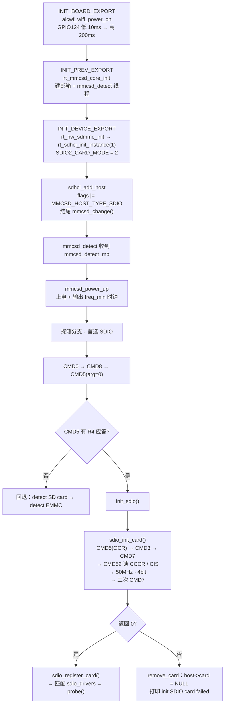

# SDIO 初始化到寻卡流程说明

本文梳理 SiFli SDK 中 **SDIO 控制器从驱动注册、上电、寻卡到驱动 probe 回调** 的完整调用链，用于 AIC8800 SDIO WiFi 模块的 bring-up 定位。

- 代码基线：`rtos/rtthread/components/drivers/sdio/`（RT-Thread mmcsd 核心）+ `rtos/rtthread/bsp/sifli/drivers/drv_sdhci.c`（SiFli SDHCI 驱动）
- 参考工程：`example/aic8800_d80`，板型 `sf32lb55-lcd_n16r4n4_hcpu`
- 本文行号对应上述基线，改动代码后请重新核对

## 1. 涉及的关键配置

| 配置项 | 值 | 位置 | 作用 |
| --- | --- | --- | --- |
| `RT_USING_SDIO` | 1 | `rtconfig.h:46` | 打开 SDIO/mmcsd 组件 |
| `RT_SDIO_STACK_SIZE` | 2048 | `rtconfig.h:47` | 探测相关线程栈 |
| `RT_SDIO_THREAD_PRIORITY` | 9 | `rtconfig.h:48` | mmcsd 探测线程优先级 |
| `BSP_USING_SDMMC2` | 1 | `rtconfig.h:206` | 使用 SDMMC2 控制器（LB55X 上对应 SDIO2） |
| `SDIO2_CARD_MODE` | 2 | `rtconfig.h:207` | **控制器工作模式 = SDIO**（见下） |
| `BSP_USING_SDHCI2` | 1 | `rtconfig.h:211` | 启用 SDHCI 驱动实例 1 |

`SDIO2_CARD_MODE = 2` 的取值经 `drv_sdhci.c:1604` 转成 host flag：

```c
mmc->flags |= (host->usr_cfg.sdio_mode << MMCSD_HOST_TYPE_POS) & MMCSD_HOST_TYPE_MASK;
```

`MMCSD_HOST_TYPE_POS = 6`（`mmcsd_host.h:111`）、`MMCSD_HOST_TYPE_SDIO = 2 << 6`（`mmcsd_host.h:115`），因此本工程 **把 SDIO 作为首选探测类型**，SD 卡 / eMMC 只在 SDIO 探测失败后才回退。

## 2. 总览



六个阶段对应的入口：

| 阶段 | 入口 | 说明 |
| --- | --- | --- |
| ① 启动 | `rt_hw_sdmmc_init()` | 注册驱动、建 host、触发探测 |
| ② 唤醒 | `mmcsd_detect()` | 探测线程收邮箱、给卡上电 |
| ③ 探测 | `mmcsd_detect_mode()` | CMD0/CMD8/CMD5 判断卡类型 |
| ④ 初始化 | `init_sdio()` → `sdio_init_card()` | 真正的 SDIO 卡初始化，**CMD7 在此** |
| ⑤ 收尾 | `sdio_register_card()` | 回调驱动 probe，或清理退出 |
| ⑥ 通道 | `sdhci_request()` | 一条命令物理上如何发出去 |

## 3. 分阶段详解

### ① 启动：注册驱动 + host 上电

三个 init 宏按优先级依次触发：

1. **`INIT_BOARD_EXPORT(aicwf_wifi_power_on)`** — 最先执行，此时调度器尚未启动，因此必须用 `HAL_Delay()` 忙等而不是 `rt_thread_mdelay()`。GPIO124 拉低 10ms、拉高 200ms，AIC8800 才会出现 bootrom 打印。
2. **`INIT_PREV_EXPORT(rt_mmcsd_core_init)`**（`mmcsd_core.c:809-835`）：
   - 初始化 `mmcsd_detect_mb`、`mmcsd_hotpluge_mb` 两个邮箱
   - 创建 **`mmcsd_detect`** 线程，优先级 `RT_THREAD_PRIORITY_HIGH - 3`，栈 `RT_MMCSD_STACK_SIZE`
   - 调用 `rt_sdio_init()`
3. **`INIT_DEVICE_EXPORT(rt_hw_sdmmc_init)`**（`drv_sdhci.c:2035-2050`）：
   - `mmcsd_set_stat(0)` 清零探测完成标志
   - `rt_hw_sdmmc_num_init(1)` → 使能 RCC → **`rt_sdhci_init_instance(1)`**（`drv_sdhci.c:1925-2018`）
   - `rt_sdhci_init_instance()` 内部顺序：
     ```
     HAL_SDHCI_MspInit()                       // 管脚/时钟 msp 初始化
     rt_sdmmc_set_clock(1, SD2_MAX_FREQ)       // 控制器时钟
     rt_sdmmc_set_dma_mode(1, SD2_DMA_MODE)    // DMA 模式
     host_ctx->usr_cfg.sdio_mode = SDIO2_CARD_MODE
     HAL_RCC_ResetModule() + HAL_Delay(20)
     sdhci_add_host()                          // 建 host 并挂 bus
     HAL_NVIC_SetPriority/EnableIRQ(SDMMC2_IRQn)
     ```
   - `HAL_NVIC_EnableIRQ` 打开 `SDMMC2_IRQn`，命令响应靠中断回来
4. **`sdhci_add_host()`**（`drv_sdhci.c:1398`）建立 host 并填 flags，关键几行（`drv_sdhci.c:1584-1607`）：

   | 行 | 代码 | 含义 |
   | --- | --- | --- |
   | 1584 | `mmc->flags = MMCSD_SUP_SDIO_IRQ` | 支持 SDIO 中断 |
   | 1599 | `mmc->flags \|= MMCSD_BUSWIDTH_4` | SDMMC2 且未定义 `SDMMC2_BUS_WIDTH_1_ONLY` 时支持 4 线 |
   | 1604 | `mmc->flags \|= (sdio_mode << MMCSD_HOST_TYPE_POS) & MMCSD_HOST_TYPE_MASK` | 决定首选探测类型 |
   | 1607 | `if (caps & SDHCI_CAN_DO_HISPD) mmc->flags \|= MMCSD_SUP_HIGHSPEED` | 支持高速模式 |

   结尾（`drv_sdhci.c:1690-1726`）：`hal_sdhci_enable_card_detection()` → 建 event/mutex → **`mmcsd_change(mmc)`**。
   本板未定义 `SD_INSERT_DETECT_PIN`，因此走 `#else` 分支，**开机即无条件触发一次探测**；若定义了插卡检测脚，则只在检测到卡时才触发。
5. **`mmcsd_change()`**（`mmcsd_core.c:627-630`）只有一句：
   ```c
   rt_mb_send(&mmcsd_detect_mb, (rt_uint32_t)host);
   ```

### ② 唤醒：探测线程开工

6. **`mmcsd_detect()`**（`mmcsd_core.c:705-765`）死循环 `rt_mb_recv(&mmcsd_detect_mb, ...)`，收到 host 后按 `host->card` 分两路：

   | 条件 | 分支 | 行为 |
   | --- | --- | --- |
   | `host->card == NULL` | 找卡 | 进 ③ 探测流程 |
   | `host->card != NULL` | 拔卡 | SDIO 卡（`sdio_function_num != 0`）**只打印 `unsupport sdio card plug out!`**，不 `rt_free`、**不置 `host->card = NULL`**；其余类型才真正释放。之后 `rt_mb_send(&mmcsd_hotpluge_mb, host)` 并 `mmcsd_stat = 0` |

7. **`mmcsd_power_up()`**（`mmcsd_core.c:555-593`）：
   ```
   io_cfg.vdd       = fls(valid_ocr) - 1
   io_cfg.bus_mode  = MMCSD_BUSMODE_OPENDRAIN
   io_cfg.bus_width = MMCSD_BUS_WIDTH_1
   io_cfg.power_mode= MMCSD_POWER_UP
   mmcsd_set_iocfg(host)  →  sdhci_set_ios()      // 真正给卡上电
   mmcsd_delay_ms(10)
   io_cfg.clock     = host->freq_min
   io_cfg.power_mode= MMCSD_POWER_ON
   mmcsd_set_iocfg(host)  →  sdhci_set_ios()      // 输出时钟
   mmcsd_delay_ms(10)                             // 凑够 74 个时钟 / 等电压稳定
   ```
   **卡是从这一步才开始有电、有时钟的**，之前总线上不会有任何命令。

8. **`mmcsd_get_detect_mode()`**（`mmcsd_core.c:641-654`）由 `flags & MMCSD_HOST_TYPE_MASK` 映射为首选模式。本工程 → `MMCSD_HOST_DETECT_SDIO`。

### ③ 探测：SDIO 优先，失败才回退

`mmcsd_detect_mode()`（`mmcsd_core.c:656-703`）三分支，命令序列分别为：

| 分支 | 命令序列 | 响应 |
| --- | --- | --- |
| SDIO | CMD0 → CMD8 → **CMD5** | CMD5 返回 R4 |
| SD 卡 | CMD0 → CMD8 → CMD55 + ACMD41 | ACMD41 返回 R3 |
| eMMC | CMD0 → CMD8 → **CMD1** | CMD1 返回 R3 |

9. 先跑首选分支（本工程即 SDIO，`mmcsd_core.c:663-673`）：
   - `mmcsd_go_idle(host)`（`mmcsd_core.c:120-148`）→ **CMD0**，`RESP_NONE` 无响应，命令前后各有 `mmcsd_delay_ms(1)`
   - `mmcsd_send_if_cond(host, valid_ocr)` → **CMD8**，**返回值被故意丢弃**（SDIO 卡不应答 CMD8，属正常）
   - `sdio_io_send_op_cond(host, 0, &ocr)`（`sdio.c:61-113`）→ **CMD5**，`arg = 0`、`RESP_R4 | CMD_BCR`；因为 `ocr == 0`，循环体第一次即 `break`，**只发一次**（探测用途）
10. 按 `err`（即 `cmd->err`，由 `mmcsd_send_cmd()` → `mmcsd_send_request()` → `host->ops->request` 一路带回）分流：
    - **CMD5 无应答** → `err != 0` → 回退 `{SDCARD, EMMC, SDIO}`（`mmcsd_core.c:46-51`）中跳过已试过的 SDIO，依次出现 `detect SD card begin`、`detect EMMC begin`
    - **CMD5 有应答** → `err == 0` → 调用 `init_sdio(host, ocr)` 进入 ④
11. **`init_sdio()`**（`sdio.c:975-1016`）前置检查：
    - `ocr & 0x7F` 非零 → 打印 `Card ocr below the defined voltage rang.` 并清掉低 7 位
    - `ocr & VDD_165_195` → 打印 `Can't support the low voltage SDIO card.` 并清掉
    - `mmcsd_select_voltage(host, ocr)` 返回 0 → 直接跳 `err`，打印 `init SDIO card failed`

### ④ 初始化：`sdio_init_card()`（CMD7 所在）

**`sdio_init_card()`**（`sdio.c:833-973`）按顺序：

12. **第二次 CMD5**（`sdio.c:840`）：这次带 `current_ocr`，`sdio_io_send_op_cond()` 内部 `for (i = 100; i; i--)` 循环，每轮检查 `cmd.resp[0] & CARD_BUSY`（`CARD_BUSY = 0x80000000`，`mmcsd_core.h:157`），轮间 `mmcsd_delay_ms(10)`。超时返回 `-RT_ETIMEOUT` → `error %d while initialising SDIO card`。
    随后 `function_num = (cmd5_resp & 0x70000000) >> 28`，即 R4 的 bit30~28。
13. `rt_malloc` 出 `rt_mmcsd_card` 并 **`host->card = card`**（`sdio.c:862-865`）。**从这一行起 `host->card` 就非空了**；后续各步失败只释放卡内资源，只有 `init_sdio()` 的 `remove_card` 才会把它置回 NULL。
14. 为 function 0 分配 `rt_sdio_function`（`sdio.c:867-876`）。
15. **CMD3**（`sdio.c:880`）：`mmcsd_get_card_addr(host, &card->rca)` → `SD_SEND_RELATIVE_ADDR`（`mmcsd_cmd.h:76`），R6 应答，`rca = resp[0] >> 16`。紧接着 `mmcsd_set_bus_mode(host, MMCSD_BUSMODE_PUSHPULL)`。
    > 此处 **未校验 `rca != 0`**，见第 5 节。
16. **CMD7（第一次）**（`sdio.c:889`）：`mmcsd_select_card(card)` → `SELECT_CARD`（`mmcsd_cmd.h:25`），`arg = card->rca << 16`、`RESP_R1 | CMD_AC`、重试 3 次。失败则 `goto err2`。
17. **CMD52 读 CCCR**（`sdio_read_cccr()`，`sdio.c:414-472`）：

    | 顺序 | 寄存器 | 用途 |
    | --- | --- | --- |
    | 1 | 0x00 `CCCR_REV` | `version = data & 0x0f`；`> SDIO_CCCR_REV_3_00` 直接打印 `unrecognised CCCR structure version` 并返回 `-RT_ERROR` |
    | 2 | 0x00 高 4 位 | `cccr.sdio_version` |
    | 3 | 0x08 `CARD_CAPS` | `multi_block` / `low_speed` / `bus_width` |
    | 4 | 0x12 `POWER_CTRL` | 仅当 `version >= SDIO_CCCR_REV_1_10` |
    | 5 | 0x13 `SPEED` | 仅当 `version >= SDIO_CCCR_REV_1_20`，取 `high_speed` |

18. **CMD52 读 CIS**（`sdio_read_cis()`，`sdio.c:516-642`）：先由 function 0 读 FBR 中的 CIS 指针（3 字节），再逐字节读 tuple：
    - `CISTPL_MANFID` → 厂商号 / 产品号
    - `CISTPL_FUNCE` → function 0 的 `func0_blk_size`、`max_tran_speed`（`cistpl_funce_func0()`）
    - 未知 tuple → 挂入链表并打印 `function %d, CIS tuple code %#x, length %d`
    - 这一阶段会**产生大量 CMD52**，是波形上最密的一段
19. **`sdio_set_highspeed()`**（`sdio.c:728-752`）双重前提，任一不满足即 `return 0` 不动作：
    - `card->host->flags & MMCSD_SUP_HIGHSPEED`
    - `card->cccr.high_speed`

    满足后读-改-写 CCCR `0x13` 的 `SDIO_SPEED_EHS` 位，并置 `card->flags |= CARD_FLAG_HIGHSPEED`。
20. **切时钟**（`sdio.c:906-913`）：有 `CARD_FLAG_HIGHSPEED` → `mmcsd_set_clock(host, 50000000)`；否则按 `card->cis.max_tran_speed`。
21. **`sdio_set_bus_wide()`**（`sdio.c:754-778`）双重前提：
    - `card->host->flags & MMCSD_BUSWIDTH_4`
    - 不是「低速卡且不支持 4bit」（`low_speed && !bus_width` 时直接返回）

    满足后读-改-写 CCCR `0x07` 的 `SDIO_BUS_WIDTH_4BIT`，再 `mmcsd_set_bus_width(host, MMCSD_BUS_WIDTH_4)`。
22. **逐个初始化 function**（`sdio.c:919-924`）：`for (i = 1; i <= function_num; i++)` → `sdio_initialize_function()`（`sdio.c:689-726`），每个 function 做：
    - `sdio_read_fbr()`（`sdio.c:662-687`）：读 `FBR + STD_FUNC_IF`，若低 4 位为 `0xF` 再读扩展接口码
    - `sdio_read_cis()`：取该 function 的 `max_blk_size`、`enable_timeout_val`

    AIC8800 通常只有 1 个 function。
23. **CMD7（第二次）**（`sdio.c:927`）：所有 function 初始化完成后再选一次卡。
24. **`sdio_register_card()`**（`sdio.c:780-812`）：card 挂到 `sdio_cards` 链表，遍历 `sdio_drivers`，`sdio_match_card()` 命中即调用 **`drv->probe(card)`** —— 这是驱动真正拿到卡的入口。
25. **失败收尾**：`err3 / err2 / err1` 逐级释放卡内资源，打印 `error %d while initialising SDIO card`；回到 `init_sdio()` 的 `remove_card` 标签（`sdio.c:1008-1015`）：
    ```c
    remove_card:
        rt_free(host->card);
        host->card = RT_NULL;
    err:
        LOG_E("init SDIO card failed");
    ```

### ⑤ 收尾：探测结束的两种状态

26. 不论成功或失败，`mmcsd_detect()` 都会执行 `mmcsd_stat = 1` 然后 `mmcsd_host_unlock()`（`mmcsd_core.c:741-742`）。可用 `mmcsd_get_stat()`（`mmcsd_core.c:631-635`）查询。
27. **hotplug 邮箱投递点**（`mmcsd_core.c`）：

    | 位置 | 分支 | 是否投递 |
    | --- | --- | --- |
    | 683 | SD 卡探测成功 | 是 |
    | 695 | eMMC 探测成功 | 是 |
    | 760 | 拔卡 | 是 |
    | — | **SDIO 探测成功** | **否** |

    因此依赖 `mmcsd_wait_cd_changed(RT_WAITING_FOREVER)` 等待 `MMCSD_HOST_PLUGED` 的代码（如驱动侧 `aicwf_aic_wifi_bus_waitready()`）在纯 SDIO 场景下收不到消息。详见第 5 节。

### ⑥ 通道：一条命令物理上怎么出去

28. **`mmcsd_send_cmd()`**（`mmcsd_core.c:102-118`）→ **`mmcsd_send_request()`**（`mmcsd_core.c:68-100`）：
    ```c
    do {
        req->cmd->retries--;
        req->cmd->err = 0;
        mmcsd_host_lock(host);
        host->ops->request(host, req);                  // → sdhci_request()
        rt_sem_take(&host->sem_ack, RT_WAITING_FOREVER);
        mmcsd_host_unlock(host);
    } while (req->cmd->err && (req->cmd->retries > 0));
    ```
    这个 `do/while` 就是 **CMD7 重试 3 次**（`mmcsd_send_cmd(host, &cmd, 3)`）的来源。
29. **`sdhci_request()`**（`drv_sdhci.c:796-835`）：
    - `present` 被硬编码为 `true`（源码注释 `card detect not work, make it always true`），即不做插卡检测
    - `sdhci_send_command()`（`drv_sdhci.c:516`）写 SDHCI 命令寄存器，内部有 10ms 的 `SDHCI_CMD_INHIBIT` 等待
    - 结尾 `mmcsd_req_complete(mmc)` 释放 `sem_ack`
30. **中断返回**：`SDMMC2_IRQHandler()`（`drv_sdhci.c:1729-1740`）→ `sdhci_irq(&sdhci_ctx[1])` → `sdhci_cmd_irq()` / `sdhci_data_irq()` 填入 `cmd->resp[]`、`cmd->err`。

## 4. SDIO 命令序列汇总

| 命令 | 常量 | 响应 | 什么时候发 | 失败后果 |
| --- | --- | --- | --- | --- |
| CMD0 | `GO_IDLE_STATE` | 无 | 无条件，每个分支开始 | 无（无响应属正常） |
| CMD8 | `SD_SEND_IF_COND` | R7 | 无条件 | 返回值被丢弃，不影响流程 |
| CMD5 | `SD_IO_SEND_OP_COND` | R4 | `arg = 0` 探测一次；带 OCR 再发一次并轮询 bit31 | 探测失败 → 回退 SD 卡 / eMMC |
| CMD3 | `SD_SEND_RELATIVE_ADDR` | R6 | 第二次 CMD5 通过后 | `goto err2` → `init SDIO card failed` |
| **CMD7** | `SELECT_CARD` | **R1** | CMD3 之后；以及所有 function 初始化之后再发一次 | `goto err2` / `goto err3` |
| CMD52 | `SD_IO_RW_DIRECT` | R5 | CMD7 成功后，读 CCCR、FBR、CIS | 各步骤返回错误码逐级清退 |
| CMD53 | `SD_IO_RW_EXTENDED` | R5 | 多字节读写 CIS 等 | 同上 |

## 5. CMD7 无响应时的定位判据

CMD7 出现在 CMD5 与 CMD3 都已被应答之后，因此「总线上看到 CMD7」本身说明 **CMD5 与 CMD3 都已成功**。若 CMD7 没有得到响应，按以下顺序排查：

| 现象 | 判断 | 说明 |
| --- | --- | --- |
| CMD7 的 `arg == 0x00000000` | CMD3 返回的 RCA 无效 | `sdio.c:880` 的 `mmcsd_get_card_addr()` 未校验 `rca != 0`。按规范 RCA=0 是「取消选中 / 广播」，卡不应答 |
| CMD7 有 R1 响应，但之后没有 CMD52 | 失败在 CMD7 之后 | 检查 `mmcsd_send_cmd()` 的返回与 CRC |
| CMD7 之后有 CMD52 | 已进入 `sdio_read_cccr()` | 关注 CCCR 版本是否 > 3.00、以及后续 `sdio_read_cis()` |
| 日志只有 `detect SDIO begin` | CMD5 已应答 | 符合下方「探测返回值」行为，不会回退 |
| 日志出现 `detect SD card begin` / `detect EMMC begin` | CMD5 未应答 | 与 CMD7 同时出现时需重新核对时序归属 |

### 已知代码行为（排查时需注意）

1. **SDIO 分支不投递 hotplug 邮箱**（`mmcsd_core.c:663-673`）。SD 卡（683）、eMMC（695）、拔卡（760）都有 `rt_mb_send(&mmcsd_hotpluge_mb, host)`，唯独 SDIO 成功分支没有。依赖 `mmcsd_wait_cd_changed(RT_WAITING_FOREVER)` 的代码将永久阻塞。
2. **探测返回值只反映 CMD5**（`mmcsd_core.c:667-672`）：
   ```c
   err = sdio_io_send_op_cond(host, 0, &ocr);
   if (!err) {
       if (init_sdio(host, ocr))   /* 返回值被丢弃 */
           mmcsd_power_off(host);
   }
   break;
   ...
   return err;                     /* 只返回 CMD5 的结果 */
   ```
   只要 CMD5 有应答，`mmcsd_detect_mode()` 就返回 0，`mmcsd_detect()` 判定「探测成功」而**不再回退**到 SD 卡 / eMMC，同时 `mmcsd_stat` 仍被置 1，而 `host->card` 可能为 NULL。
3. **拔卡分支不释放 SDIO 卡**（`mmcsd_core.c:748-751`）：SDIO 卡走拔卡分支时只打印 `unsupport sdio card plug out!`，既不 `rt_free` 也不置 `host->card = NULL`。
4. **`err3` 清理不完整**（`sdio.c:941-956`）：循环内释放第一个命中的 function 后即 `break`，多个 function 时会泄漏。仅在走到 `err3` 时触发。

## 6. 调试打印开关

| 层 | 开关 | 可看到的内容 |
| --- | --- | --- |
| SDHCI 驱动层（**信息最全**） | 取消 `drv_sdhci.c:18` 的 `//#define DRV_DEBUG` 注释 | `drv_sdhci.c:608` 附近逐条打印 `CMD:SELECT_CARD(7) ARG:0x00000100 RES:R1 ...`，**含 CMD 号、arg 与响应类型**，是判断 CMD7 arg 的直接依据 |
| 旧 SDIO 控制器驱动 | 取消 `drv_sdio.c:24` 的 `//#define DRV_DEBUG` 注释 | 同上，仅在使用 `drv_sdio.c` 时生效 |
| 核心层 sdio / sd / mmc / mmcsd_core | Kconfig 打开 `RT_SDIO_DEBUG` | 令这些文件的 `DBG_LVL = DBG_LOG`，输出 `LOG_D` 级信息（如 `bad CISTPL_FUNCE size`） |

> **注意**：本工程已启用 ULOG（`RT_USING_ULOG = 1`）。`rtdbg.h` 在 ULOG 模式下直接 `#include <ulog.h>`，`LOG_D` 由 ulog 无条件提供，运行时只受 `ULOG_OUTPUT_LVL` 过滤，`DBG_LVL` 不再参与。当前 `ULOG_OUTPUT_LVL = 7`（Debug）且未启用 `ULOG_USING_FILTER`，因此核心层的 `LOG_D` **默认已经打开**，`RT_SDIO_DEBUG` 在该配置下基本无额外效果。若串口看不到，优先排查缓冲区截断与波特率。

## 7. 关键日志对照表

| 日志 | 出处 | 含义 |
| --- | --- | --- |
| `rt_hw_sdmmc_init %d begin` / `done` | `drv_sdhci.c:1932` / `1995` | 控制器实例初始化开始 / 结束 |
| `host version` / `host minclock ... maxclock ...` | `drv_sdhci.c` | host 能力查询结果 |
| `Add host success` | `drv_sdhci.c:1723` | host 挂载完成，即将触发探测 |
| `detect SDIO begin` | `mmcsd_core.c:664` | 进入 SDIO 探测分支 |
| `detect SD card begin` / `detect EMMC begin` | `mmcsd_core.c:675` / `687` | 回退分支被触发（说明前一个分支未应答） |
| `Card ocr below the defined voltage rang.` | `sdio.c:984` | CMD5 返回的 OCR 低 7 位非零 |
| `Can't support the low voltage SDIO card.` | `sdio.c:990` | OCR 含 1.65~1.95V 位，本平台不支持 |
| `unrecognised CCCR structure version %d` | `sdio.c:430` | CCCR 版本高于 3.00 |
| `error %d while initialising SDIO card` | `sdio.c:970` | `sdio_init_card()` 失败，`err` 为具体错误码 |
| `init SDIO card failed` | `sdio.c:1013` | `init_sdio()` 整体失败，`host->card` 已被置 NULL |
| `unsupport sdio card plug out!` | `mmcsd_core.c:750` | 拔卡分支遇到 SDIO 卡，未释放 |

## 8. 相关文件索引

| 文件 | 职责 |
| --- | --- |
| `rtos/rtthread/components/drivers/sdio/mmcsd_core.c` | 探测线程、邮箱、电源时序、命令发送 |
| `rtos/rtthread/components/drivers/sdio/sdio.c` | SDIO 卡初始化、CCCR / CIS 解析、驱动注册与 match |
| `rtos/rtthread/components/drivers/sdio/sd.c` / `mmc.c` | SD 卡 / eMMC 探测与初始化 |
| `rtos/rtthread/components/drivers/include/drivers/mmcsd_cmd.h` | 命令码定义（CMD0/CMD3/CMD5/CMD7/CMD52…） |
| `rtos/rtthread/components/drivers/include/drivers/mmcsd_core.h` | `CARD_BUSY`、卡内结构体定义 |
| `rtos/rtthread/components/drivers/include/drivers/mmcsd_host.h` | host flags、`MMCSD_HOST_TYPE_*` 定义 |
| `rtos/rtthread/bsp/sifli/drivers/drv_sdhci.c` | SiFli SDHCI 控制器驱动（host 注册、请求下发、中断） |
