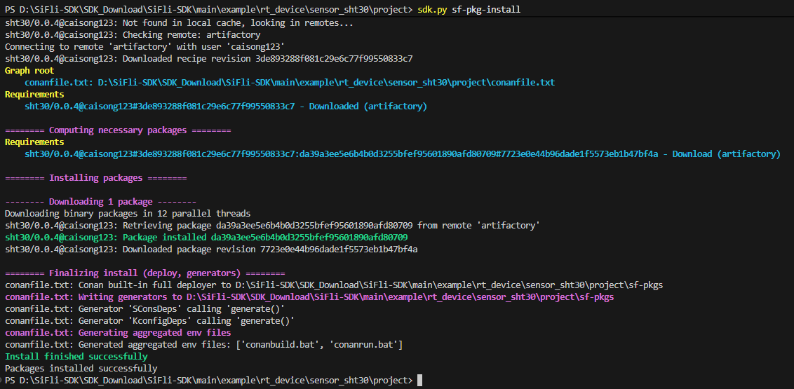

# 在工程中使用 SiFli 组件注册表

以下步骤说明如何在现有工程中安装和使用 SiFli 组件注册表 依赖。

```{note}
当前页面中的部分截图仍来自旧版命令界面；若截图中的命令格式与正文不同，请以当前 `sdk.py sf-pkg ...` 命令为准。
```

## 初始化依赖（sf-pkg init）

```bash
sdk.py sf-pkg init
```

执行成功后，会在 `project` 目录下生成一份 `sf-pkg.yaml` 声明文件（YAML 格式，支持注释），例如：

```yaml
# 工程级固定依赖：每一项为 <包名>/<版本号>@<用户名>
requires:
  - sht30/0.0.4@caisong123                 # 精确版本
  - battery_calculator/[>=1.2 <2.0]@sifli  # 版本区间（Conan 语法，见下文“版本区间写法”）
  - legacy-lib/[*]@acme                    # 任意版本

# 可选：工程要求的 SDK 区间（npm semver 语法，与 requires 不同）
# 不写则不做 SDK 版本检查，等同于写成 "*"
# support_sdk_version: ">=2.4 <3"
```

`requires` 为空即表示不依赖任何包；需要时按 `<包名>/<版本号>@<用户名>` 格式添加即可，例如添加 SHT30 传感器驱动包：`sht30/0.0.4@caisong123`。版本号也可以写成区间，具体语法见下文[版本区间写法](#版本区间写法)。

```{note}
早期版本通过 `conanfile.py` 声明依赖。若工程根存在 `conanfile.py` 且没有 `sf-pkg.yaml`，`sf-pkg install` 会视为"高级模式"，直接对它执行 `conan install`（保持旧行为，不参与模块级依赖聚合）。建议新工程使用 `sf-pkg.yaml`。
```

### sf-pkg.yaml 字段说明

`sf-pkg.yaml` 同时用于工程根与 SDK 内置模块，字段说明如下：

- `requires`（列表，可选）：本工程/本模块需要的外置组件。每一项格式为 `<包名>/<版本号>@<用户名>`，版本可写区间（Conan 语法），例如 `sht30/0.0.4@caisong123`、`battery_calculator/[>=1.2 <2.0]@sifli`。为空或不写等价于无依赖。
- `support_sdk_version`（字符串，可选）：声明要求的 SDK 版本区间，使用 npm 风格 semver（如 `>=2.4 <3`、`>=2.4.1 <2.5.0`，简写形式 `^2.4`、`~2.4.1` 也支持，注意与 `requires` 的语法不同）；不写则不检查，等同于写成 `"*"`。安装/构建时会用环境变量 `SIFLI_SDK_VERSION` 校验，不满足即在联网前报错并指明来源文件。工程根与每个模块各自声明、分别校验。
- `enable`（列表，可选，**仅模块清单使用**）：模块的 Kconfig 使能符号，列表中**任一**为 `y` 即视为"本模块参与编译"，此时它的 `requires` 才会并入拉取集合；全部不满足则不拉取。这里填 Kconfig 中定义的**真实符号名**（`.config` 行首的 `CONFIG_` 是 kconfig 写文件时自动加的，不算符号名的一部分；若符号名本身就以 `CONFIG_` 开头，则如实填写）。若省略/为空则视为"总是参与"，仅适合确实没有开关的固定模块。

工程根 `sf-pkg.yaml` 中 `enable` 不生效——工程根是固定依赖，`sf-pkg.yaml` 只需写 `requires`（和可选的 `support_sdk_version`）。

### 版本区间写法

`requires` 和 `support_sdk_version` 使用**两套不同的版本语法**，写串了会导致解析失败或找不到包：

| 字段 | 解析器 | 区间写法 | 示例 |
|---|---|---|---|
| `requires` | Conan 2 | 方括号内写条件，空格分隔 | `foo/[>=1.2 <2.0]@sifli` |
| `support_sdk_version` | npm semver | 不加方括号，空格分隔 | `>=2.4 <3` |

#### requires：Conan 版本区间

格式为 `<包名>/[<区间>]@<用户名>[/<渠道>]`，方括号只包住版本部分。不写方括号表示精确版本（如 `sht30/0.0.4@caisong123`）。

**推荐直接写出上下界**，最不容易误解：

| 写法 | 含义 |
|---|---|
| `[>=1.2 <2.0]` | 1.2 及以上、2.0 以下（含 1.2.0，不含 2.0.0） |
| `[>=1.2.3 <1.5.0]` | 1.2.3 及以上、1.5.0 以下 |
| `[>=1.2]` | 1.2 及以上，不设上限 |
| `[<2.0]` | 2.0 以下 |
| `[1.2.3]` | 只有 1.2.3 |
| `[*]` | 任意版本（仍不包含预发布版本） |

规则说明：

- 多个条件是“且”的关系，用**空格**分隔；条件组之间“或”用 `||`，如 `[>=1.0 <2.0 || >=3.0 <4.0]`。
- **逗号不是“且”**，它只用于分隔区间选项（如 `include_prerelease`）。写成 `>=1.2,<2.0` 会直接报错：`"<2.0" in version range ">=1.2,<2.0" is not a valid option`。
- `>=` 的下界本身被包含，`<` 的上界不被包含；要让上界也被包含就写 `<=`。
- 默认不匹配预发布版本（如 `1.3.0-beta1`），需要时在区间里加 `, include_prerelease`。
- 安装时由 Conan 从远端挑选满足区间的**最高版本**；多个模块对同一个包声明不同区间时取交集。

简写形式（可选，不熟悉可以只用上面的显式写法）：

| 写法 | 等价于 | 说明 |
|---|---|---|
| `[^1.2]` | `>=1.2 <2.0` | 锁定最左边不为 0 的分量，即主版本不变 |
| `[~1.2]` | `>=1.2 <1.3` | 锁定次版本 |
| `[~1.2.3]` | `>=1.2.3 <1.3` | 锁定次版本，起点为 1.2.3 |
| `[1.2.*]` | `1.2.x` | 前缀通配 |

注意 0.x 版本下 `^` 的行为与直觉不同：`[^0.2]` 是 `>=0.2 <0.3`，`[^0.0.3]` 是 `>=0.0.3 <0.0.4`。这类情况建议直接写 `>= x < y`。

示例：

```yaml
requires:
  - sht30/0.0.4@caisong123                  # 精确版本
  - battery_calculator/[>=1.2 <2.0]@sifli   # 1.2 ~ 1.9.x
  - mesh-lib/[>=1.3 <2.0]@acme              # 显式写出上下界
  - codec/[>=1.4.2 <1.5.0]@sifli            # 只接受 1.4.x，且不低于 1.4.2
  - compat/[>=1.0 <2.0 || >=3.0 <4.0]@acme  # 1.x 或 3.x
  - legacy-lib/[*]@acme                     # 任意版本
```

#### support_sdk_version：npm semver 区间

SDK 版本取自环境变量 `SIFLI_SDK_VERSION`，由 `export.ps1` / `set_env.bat` 设置为 `<主版本>.<次版本>`（如 `2.5`），校验时按 `2.5.0` 处理。

**推荐同样直接写上下界**：

| 写法 | 含义 |
|---|---|
| `>=2.4 <3` | 2.4 及以上、3.0.0 以下（推荐） |
| `>=2.4.0 <2.6.0` | 完整三段写法，更明确 |
| `>=2.4` | 2.4 及以上，不设上限 |
| `*` | 任意版本 |

规则说明：

- 多个条件用**空格**分隔。**不要用逗号**：`>=2.4,<3` 无法解析，会报 `Invalid NPM block`。
- 省略的分量按 0 补齐，`>=2.4` 与 `>=2.4.0` 等价；环境里的 SDK 版本如 `2.5` 也按 `2.5.0` 参与比较。
- 不写 `support_sdk_version` 就不做版本检查，等同于写成 `*`；`*` 本身也可以显式写出来，但通常没有必要。
- 不满足时会在联网前报错，并指明是哪个 `sf-pkg.yaml` 声明的。

简写形式（可选）：

| 写法 | 等价于 | 说明 |
|---|---|---|
| `^2.4` | `>=2.4.0 <3.0.0` | 主版本不变 |
| `~2.4` | `>=2.4.0 <2.5.0` | 次版本不变 |
| `~2.4.1` | `>=2.4.1 <2.5.0` | 只允许补丁号升级 |
| `2.4.x` | `>=2.4.0 <2.5.0` | 前缀通配 |

示例：

```yaml
support_sdk_version: ">=2.4 <3"       # 2.4.0 及以上、3.0.0 以下的 SDK（推荐）
# support_sdk_version: ">=2.4.1 <2.5.0"  # 只接受 2.4.x，且不低于 2.4.1
# support_sdk_version: "*"               # 任意版本（与不写等价）
```

### 模块级外置依赖（模块清单）

SDK 内置模块（如 `middleware/*`、板级驱动等）也可以各自携带一份 `sf-pkg.yaml`，声明"仅当本模块参与编译时才需要拉取"的外置组件：

```yaml
# middleware/<module>/sf-pkg.yaml
# 必须放在"定义该模块使能符号的 Kconfig"同目录
enable:
  - BLE_STACK            # Kconfig 使能符号，任一为 y 即参与
requires:
  - mesh-lib/1.3.0@acme  # conan 引用，格式同工程根
support_sdk_version: ">=2.4 <3"   # 可选，同工程根语义
```

- 这份清单必须与其模块的 Kconfig 放在**同一目录**，且该 Kconfig 要在当前板子的配置树内被解析到，否则清单不会被发现（不参与就不会拉取）。
- 模块启用时，除拉取外还要让包参与链接：在模块自己的 Kconfig 里对包在 `Kconfig.conandeps` 中声明的使能符号做 `select`。
- 更完整的机制与约定见 [模块级依赖设计文档](design/module_deps.md)。

## 搜索可用的包

如果不确定包名或版本号，可以搜索：

```bash
sdk.py sf-pkg search <package_name>
```

示例：

```bash
sdk.py sf-pkg search sht30
```
也可以直接在组件注册表官网进行搜索：点此访问 [SiFli组件注册表](https://packages.sifli.com/)


## 安装依赖（sf-pkg install）

在工程的 `project` 目录下执行：

```bash
sdk.py sf-pkg install
```

- 不带 `--board`：只按工程根 `sf-pkg.yaml` 的 `requires` 安装，不合并模块级依赖。
- 带 `--board <board>`：额外把该板配置中"启用模块"声明的外置组件合并安装；会先自动按 board.conf + proj.conf 解析该板配置（生成构建目录内的 `kconfiglist`/`.config`），无需先编译。
- 带 `--board-search-path <dir>`：在 SDK `customer/boards` 之外附加板子搜索目录（同 scons `--board_search_path`；也可用环境变量 `SIFLI_SDK_BOARD_SEARCH_PATH`）。



安装成功后，会在 `project` 目录下生成 `sf-pkgs` 文件夹，其中包含了所安装的包。

### 构建时自动拉取

只要工程根存在 `sf-pkg.yaml`，执行 `scons --board=<b>` 时构建入口会自动检测"本次板配置下启用模块"的依赖集合是否有变化，有变化则自动安装后再继续编译（幂等，未变化会跳过）。需要关闭自动拉取时：

```bash
SIFLI_SF_PKG_OFFLINE=1 scons --board=<b>     # 或使用 scons --no-sf-pkg
```

## 使用驱动

安装完成后即可直接使用驱动：

- 可以直接编译
- include 头文件时无需填写绝对路径，Conan 会自动处理路径配置

### Kconfig 配置注意事项

- `menuconfig` 会自动整合 `sf-pkgs` 文件夹下的所有 `Kconfig` 文件
- 这些配置项会出现在 `menuconfig` 的 **SiFli External Components** 菜单中
