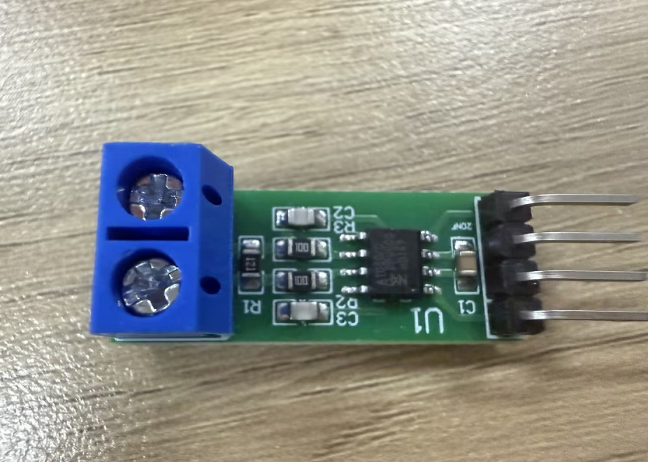
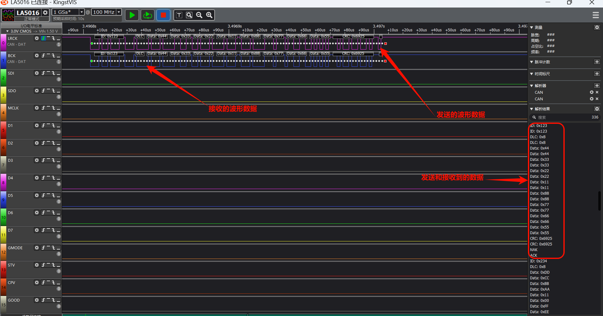

# CAN 接收示例（can_rx）

源码路径: example/hal/can/can_rx

## 支持的平台
例程可以运行在以下开发板上.
* sf32lb56-lcd
* sf32lb58-lcd

## 概述
* 本例程演示了如何使用芯片的 CAN 控制器完成 CAN 数据接收功能，覆盖过滤器配置和中断/轮询两种取帧方式。
* 本例程作为 CAN 通信的接收端（Board B），与 can_tx 例程（发送端，Board A）配合，在两块开发板之间进行单向 CAN 通信：can_tx 发送，can_rx 接收。
* 本例程支持轮询与中断两种工作方式，通过 `USE_CAN_IT` 宏切换。中断方式下由 RIF 中断配合信号量完成 ISR 与主循环的同步，无需轮询寄存器。
* 基于本例程可以实现 CAN 总线上的数据采集、命令下发接收等场景。

## 硬件要求
- 两块支持 CAN 功能的开发板（如 sf32lb56-lcd 或 sf32lb58-lcd）：一块烧录 can_tx 例程作为发送端，另一块烧录本例程作为接收端
- 两个 CAN 收发器模块（如 TJA1050，需 5V 供电）
- 杜邦线若干

## 硬件连接
* 如果开发板把 CAN 使用的引脚复用为 UART，需先拆除该 UART 上的串阻。`sf32lb56-lcd` 需移除下图中的两个电阻（位于 PA03/PA04 上），具体位置可以参考下图


**sf32lb56-lcd** 与 CAN 收发器连接：

开发板引脚 | CAN 收发器
--|--
PA03（8） | TX
PA04（9） | RX
5V | VCC
GND | GND

**sf32lb58-lcd** 与 CAN 收发器连接：

开发板引脚 | CAN 收发器
--|--
PA00 | TX
PA03 | RX
5V | VCC
GND | GND

两块开发板的 CAN 收发器之间连接：

CAN 收发器（can_tx 端） | CAN 收发器（can_rx 端）
--|--
CANH | CANH
CANL | CANL

* TJA1050 模块丝印为 `CHAN`/`CHAL`，与标准 CAN 的 `CANH`/`CANL` 等同
* CANH 需对 CANH、CANL 需对 CANL，不可交叉；总线两端各需一个 120Ω 终端电阻

* CAN收发器（TJA1050）



## 用法

下面的小节仅提供绝对必要的信息。有关配置 SiFli-SDK 及使用其构建和运行项目的完整步骤，请参阅 [SiFli-SDK 快速入门](https://docs.sifli.com/projects/sdk/latest/sf32lb52x/quickstart/index.html)。

### 编译和烧录
* 分别编译烧录 can_tx 和 can_rx 两个工程到对应的板子：can_tx 例程烧录到发送端（Board A），本例程（can_rx）烧录到接收端（Board B）
* 切换到例程的 `project` 目录（例如 `example/hal/can/can_rx/project`），运行 scons 命令执行编译：

```bash
scons --board=sf32lb56-lcd_a128r12n1 -j8
```

* 编译完成后，运行 `build_sf32lb56-lcd_a128r12n1_hcpu/download.bat`，程序通过 JLink 自动下载
* 或使用串口下载：`build_sf32lb56-lcd_a128r12n1_hcpu/uart_download.bat`

### 配置项目

CAN 的码率和轮询/中断方式均在源码宏中配置（`can_rx/src/main.c`）：

宏 | 默认值 | 说明
--|--|--
`CAN_BITRATE` | 400000 | CAN 目标码率，`HAL_CAN_CalcTiming` 据此反算预分频与位时间段参数，发送端与接收端需保持一致
`USE_CAN_IT` | 1 | 工作方式，0=轮询，1=中断

如需修改 console 串口或日志开关，可在例程目录下进入 menuconfig（`proj.conf` 中已将 console 切换到 UART4）：

```bash
sdk.py menuconfig --board=<board_name>
```

## 示例输出
如果示例运行成功，您将在串口看到以下输出：

* can_rx的log输出（中断模式 `USE_CAN_IT=1`，需 can_tx 板配合发送）

```
01-13 17:07:26:864     \ | /
01-13 17:07:26:865    - SiFli Corporation
01-13 17:07:26:868     / | \     build on Dec 25 2025, 2.4.0 build befba178
01-13 17:07:26:869     2020 - 2022 Copyright by SiFli team
01-13 17:07:26:873    mount /dev sucess
01-13 17:07:26:874    [I/drv.audprc] init 00 ADC_PATH_CFG0 0x924
01-13 17:07:26:877    [I/drv.audprc] HAL_AUDPRC_Init res 0
01-13 17:07:26:878    [I/drv] HAL_AUDCODEC_Init res 0
01-13 17:07:26:878    [I/TOUCH] Regist touch screen driver, probe=1001aa4d
01-13 17:07:26:882    call par CFG1(35bb)
01-13 17:07:26:883    fc 9, xtal 2000, pll 2038
01-13 17:07:26:887    call par CFG1(35bb)
01-13 17:07:26:889    fc 9, xtal 2000, pll 2038
01-13 17:07:26:890    CAN IT mode: RX-only board (semaphore + GetRxMessage).
01-13 17:07:27:068    [RECV Primary] ID=0x123, DLC=8, Data=0x11223344 0x55667788
01-13 17:07:27:570    [RECV Secondary] ID=0x103, DLC=8, Data=0xAAAA0003 0xBBBB0003
01-13 17:07:29:571    [RECV Primary] ID=0x123, DLC=8, Data=0x11223344 0x55667788
01-13 17:07:30:073    [RECV Secondary] ID=0x103, DLC=8, Data=0xAAAA0003 0xBBBB0003
01-13 17:07:32:074    [RECV Primary] ID=0x123, DLC=8, Data=0x11223344 0x55667788
01-13 17:07:32:576    [RECV Secondary] ID=0x103, DLC=8, Data=0xAAAA0003 0xBBBB0003
```

* 轮询模式（`USE_CAN_IT=0`）下每 100ms 轮询一次，输出为 `[RECV ...]` 格式（此处省略串口时间戳）：

```
CAN polling mode: RX-only board.
Filters: Primary=0x123, Secondary=0x103

[RECV Primary] ID=0x123, DLC=8, Data=0x11223344 0x55667788
[RECV Secondary] ID=0x103, DLC=8, Data=0xAAAA0003 0xBBBB0003
...
```

### CAN读写波形
* 本例程只负责接收，下图是两块开发板通信时的 CAN 总线波形



### CAN参数修改
```c
static void CAN_Config(void)
{
  hcan.Instance = CAN1;

  /* Derive the prescaler and bit-timing segments from the target bitrate */
  if (HAL_CAN_CalcTiming(&hcan, CAN_BITRATE) < 0)
  {
    rt_kprintf("Failed to calculate CAN timing.\n");
    Error_Handler();
  }

  if (HAL_CAN_Init(&hcan) != HAL_OK)
  {
    rt_kprintf("CAN initialization failed.\n");
    Error_Handler();
  }

  CAN_FilterTypeDef can_filter_config;

  // Configure standard frame filter (ID=0x123, FilterBank=0)
  can_filter_config.FilterId = 0x123;
  can_filter_config.FilterMask = 0x7FF; // Exact match for standard ID
  can_filter_config.FilterBank = 0;
  can_filter_config.FilterActivation = ENABLE;
  can_filter_config.IDECheckEnable = ENABLE;
  can_filter_config.IDEValue = CAN_ID_STD; // Only accept standard frames
  if (HAL_CAN_ConfigFilter(&hcan, &can_filter_config) != HAL_OK)
  {
    rt_kprintf("Failed to configure CAN filter 0.\n");
    Error_Handler();
  }

  // Configure standard frame filter (ID=0x103, FilterBank=1)
  can_filter_config.FilterId = 0x103;
  can_filter_config.FilterMask = 0x7FF; // Exact match for standard ID
  can_filter_config.FilterBank = 1;
  can_filter_config.FilterActivation = ENABLE;
  can_filter_config.IDECheckEnable = ENABLE;
  can_filter_config.IDEValue = CAN_ID_STD; // Only accept standard frames
  if (HAL_CAN_ConfigFilter(&hcan, &can_filter_config) != HAL_OK)
  {
    rt_kprintf("Failed to configure CAN filter 1.\n");
    Error_Handler();
  }
}
```
* 首先调用 `HAL_CAN_CalcTiming`，按 `CAN_BITRATE`（默认 400kbps）反算出预分频与位时间段参数（该函数内部按 48MHz CAN 时钟计算），不再写死预分频值
* 随后配置两条过滤器，`can_filter_config.FilterId` 分别为 0x123（FilterBank=0）和 0x103（FilterBank=1），即只接收这两个 ID 的标准帧
* 通过`can_filter_config.FilterMask`设置过滤掩码，0x7FF 表示标准帧 11 位 ID 全部精确匹配，扩展帧使用 0x1FFFFFFF
* 通过`can_filter_config.FilterBank`,来配置过滤器编号（0~15）
* 通过`can_filter_config.FilterActivation`，来控制过滤器是否启用
* 通过`can_filter_config.IDECheckEnable`，来控制是否启用 IDE 检查，以区分标准帧与扩展帧
* 通过`can_filter_config.IDEValue`,用来控制接收标准帧还是扩展帧

### CAN中断模式说明

* 本例程通过 `USE_CAN_IT` 宏切换工作方式（0=轮询，1=中断）。中断模式下，CAN 控制器通过硬件中断通知 CPU，无需轮询寄存器，能大幅降低 CPU 占用。
* 测试需要两块开发板：**can_tx**（发送端，Board A）和 **can_rx**（接收端，Board B），两块板子均烧录中断模式固件。

#### ISR 基础设施

```c
void CAN1_IRQHandler(void)
{
    rt_interrupt_enter();

    HAL_CAN_IRQHandler(&hcan);   // 统一入口，识别中断源并分发到对应回调

    rt_interrupt_leave();
}

void HAL_CAN_MspInit(CAN_HandleTypeDef *hcan)
{
    if (hcan->Instance == hwp_can1)
    {
        NVIC_EnableIRQ(CAN1_IRQn);
    }
}
```

`HAL_CAN_Init` 首次调用时自动回调 `HAL_CAN_MspInit`，在此使能 NVIC。

#### 接收端（can_rx / Board B）

使用信号量实现 ISR→主循环同步。RIF 回调释放信号量，主循环等待后批量读出 RBUF 中所有待处理帧：

```c
static rt_sem_t can_rx_sem = RT_NULL;

void HAL_CAN_RxMsgPendingCallback(CAN_HandleTypeDef *hcan)
{
    /* 中断上下文中仅做信号通知 */
    rt_sem_release(can_rx_sem);
}

int main(void)
{
    /* CAN 初始化、Filter 配置、Start 之后 */
    can_rx_sem = rt_sem_create("can_rx", 0, RT_IPC_FLAG_FIFO);
    HAL_CAN_ActivateNotification(&hcan, CAN_IT_RX_MSG_PENDING);

    while (1)
    {
        if (rt_sem_take(can_rx_sem, RT_WAITING_FOREVER) == RT_EOK)
        {
            CAN_RxHeaderTypeDef rx_header;
            uint8_t rx_data[8];

            while (HAL_CAN_GetRxFifoFillLevel(&hcan) > 0)
            {
                if (HAL_CAN_GetRxMessage(&hcan, &rx_header, rx_data) == HAL_OK
                        && rx_header.DLC > 0)
                {
                    /* 打印接收到的帧（略） */
                }
            }
        }
    }
}
```

> 接收端配置了两个 filter（ID=0x123 和 ID=0x103），对端 can_tx 经主发送缓冲区发出的 0x123 帧和经副发送缓冲区批量发出的第 3 帧（ID=0x103）均能被接收，其余被硬件过滤。日志中的 `Primary`/`Secondary` 标签按帧 ID 区分，接收端硬件本身不携带"发送方使用哪个缓冲区"的信息。

#### 中断类型汇总

| 参数宏 | 手册标志 | 回调函数 | 触发时机 |
|--|--|--|--|
| `CAN_IT_RX_MSG_PENDING` | RIF | `HAL_CAN_RxMsgPendingCallback` | 每收到一帧 |
| `CAN_IT_RX_FIFO_FULL` | RFIF | `HAL_CAN_RxFifoFullCallback` | RBUF（接收缓冲）满 |
| `CAN_IT_RX_OVERRUN` | ROIF | `HAL_CAN_RxFifoOverflowCallback` | 接收溢出* |
| `CAN_IT_RX_ALMOST_FULL` | RAFIF | `HAL_CAN_RxFifoAlmostFullCallback` | RBUF（接收缓冲）接近满 |
| `CAN_IT_TX_PTB_EMPTY` | TPIF | `HAL_CAN_TxPrimaryCompleteCallback` | 主发送缓冲区（PTB）发送完成 |
| `CAN_IT_TX_STB_EMPTY` | TSIF | `HAL_CAN_TxSecondaryCompleteCallback` | 副发送缓冲区（STB）发送完成（每帧调用一次） |

\* 当前 HAL 实现中溢出分支会触发 `HAL_ASSERT(0)`，请勿依赖该回调做正常运行时的溢出处理。

上表列出 CAN 支持的全部中断类型，本例程（can_rx）实际只使能了 `CAN_IT_RX_MSG_PENDING`。

「手册标志」列为芯片手册中 IR 寄存器的中断标志位名称（TPIF/TSIF/RIF 等即为缩写原文），PTB/STB 分别指 Primary/Secondary Transmit Buffer（主/副发送缓冲区），RBUF 指接收缓冲（Receive Buffer）。

通过按位或 `|` 可同时使能多个中断，如 `CAN_IT_RX_MSG_PENDING | CAN_IT_RX_FIFO_FULL`。

#### 完整收发流程

本例程只演示单向通信：can_tx 发送，can_rx 接收。

```
Board A (can_tx)                          Board B (can_rx)
─────────────────                         ─────────────────
① Primary: ActivateNotification(TPIF)
   AddPrimaryTxMessage()
   → 帧(0x123) 发送
   → TPIF → PrimaryCompleteCallback       ② RIF → RxMsgPendingCallback
                                             → sem_release
                                             → GetRxMessage → 收到 0x123

③ Secondary: ActivateNotification(TSIF)
   AddSecondaryTxMessage() × 3
   → 帧(0x101, 0x102, 0x103) 批量发出
   → TSIF → SecondaryCompleteCallback×3   ④ RIF → RxMsgPendingCallback
                                             → sem_release
                                             → 读出 0x103（其余被 filter 过滤）
```

## 异常诊断
* 如果跟log打印不一致或者波形不一致，请检查以下内容：
    1. 检查硬件接线是否正确，是否跟上述说明的接线是一致（CANH 接 CANH、CANL 接 CANL，TX/RX 不要接反）
    2. 检查 `sf32lb56-lcd` 上 PA03/PA04 复用 UART 的两个串阻是否已拆除
    3. 检查 CAN 总线两端是否各接了一个 120Ω 终端电阻
    4. 检查发送端与接收端的 CAN 码率是否一致（默认均为 400kbps）
    5. 检查 CAN 收发器模块是否已 5V 供电，且与开发板共地
    6. 对端未上电或未接入总线时，发送方收不到 ACK，发送会失败，请确认两块板均已上电

如有任何技术疑问，请在 GitHub 上提出 [issue](https://github.com/OpenSiFli/SiFli-SDK/issues)。

## 参考文档
- [SiFli-SDK 快速入门](https://docs.sifli.com/projects/sdk/latest/sf32lb52x/quickstart/index.html)
- [SiFli-SDK 开发指南](https://docs.sifli.com/projects/sdk/latest/sf32lb52x/development/index.html)
