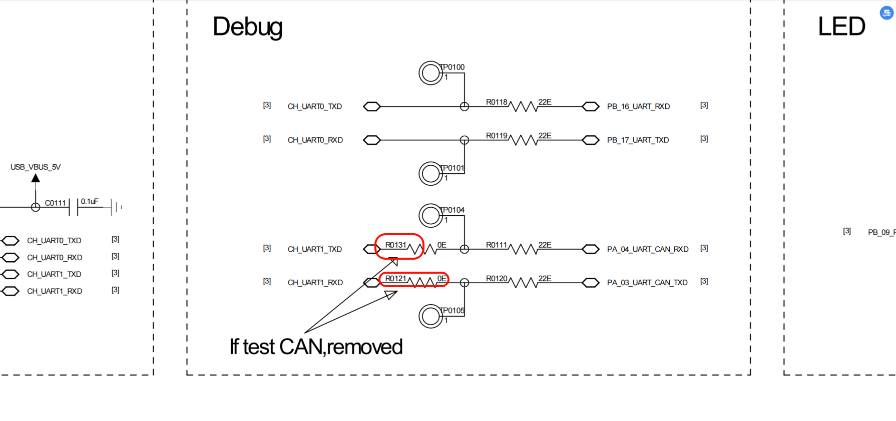
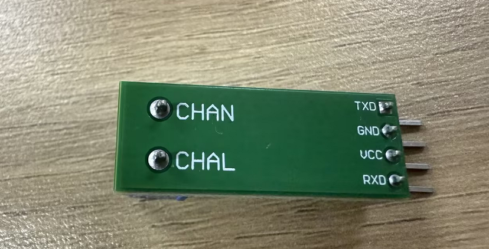

# CAN Transmit Example (can_tx)

Source Path: example/hal/can/can_tx

## Supported Platforms
This example can run on the following development boards.
* sf32lb56-lcd
* sf32lb58-lcd

## Overview
* This example demonstrates how to use the chip's CAN controller to implement CAN data transmission, covering both single-frame transmission through the primary transmit buffer (PTB) and multi-frame batch transmission through the secondary transmit buffer (STB).
* This example operates as the sending end (Board A) of CAN communication. Together with the can_rx example (receiver, Board B), it forms one-way CAN communication between two development boards: can_tx sends and can_rx receives.
* The example supports polling and interrupt modes, switched via the `USE_CAN_IT` macro. In interrupt mode, transmission completion is reported through NVIC interrupts and HAL callbacks, with no register polling required.
* Typical use cases derived from this example include periodic data reporting and batch transmission of multiple frames.

## Hardware Requirements
- Two SiFli development boards with CAN support (such as sf32lb56-lcd or sf32lb58-lcd): one flashed with this example as the sender, the other flashed with the can_rx example as the receiver
- Two CAN transceiver modules (such as TJA1050, powered from 5V)
- Several Dupont wires

## Hardware Connection
* If the board multiplexes the CAN pins with a UART, remove the series resistors on that UART first. On `sf32lb56-lcd`, remove the two resistors shown below (they are on PA03/PA04).


**sf32lb56-lcd** to CAN transceiver connection:

Board Pin | CAN Transceiver
--|--
PA03 (8) | TX
PA04 (9) | RX
5V | VCC
GND | GND

**sf32lb58-lcd** to CAN transceiver connection:

Board Pin | CAN Transceiver
--|--
PA00 | TX
PA03 | RX
5V | VCC
GND | GND

Between the two development boards' CAN transceivers:

CAN Transceiver (can_tx side) | CAN Transceiver (can_rx side)
--|--
CANH | CANH
CANL | CANL

* The TJA1050 module is silk-screened with `CHAN`/`CHAL`, which are equivalent to the standard CAN `CANH`/`CANL`
* CANH must connect to CANH and CANL to CANL; do not cross them. One 120Ω termination resistor is required at each end of the bus

* CAN transceiver (TJA1050)




## Usage

The sections below only cover the essential information. For the complete steps to configure SiFli-SDK and build/run the project, see the [SiFli-SDK Quick Start Guide](https://docs.sifli.com/projects/sdk/latest/sf32lb52x/quickstart/index.html).

### Compilation and Download
* Compile and flash the can_tx and can_rx projects separately to the corresponding boards: this project (can_tx) is flashed to the sending board (Board A), and the can_rx example to the receiving board (Board B)
* Switch to the example's `project` directory (for example `example/hal/can/can_tx/project`) and run the scons command to compile:

```bash
scons --board=sf32lb56-lcd_a128r12n1 -j8
```

* After compilation, run `build_sf32lb56-lcd_a128r12n1_hcpu/download.bat`; the program is downloaded automatically via JLink
* Or use UART download: `build_sf32lb56-lcd_a128r12n1_hcpu/uart_download.bat`

### Project Configuration

The CAN bitrate and the polling/interrupt mode are both configured by macros in the source (`can_tx/src/main.c`):

Macro | Default | Description
--|--|--
`CAN_BITRATE` | 400000 | Target CAN bitrate. `HAL_CAN_CalcTiming` derives the prescaler and bit-timing segments from it; the sender and receiver must use the same value
`USE_CAN_IT` | 1 | Working mode: 0 = polling, 1 = interrupt

To adjust the console UART or log switches, run menuconfig in the example directory (`proj.conf` already switches the console to UART4):

```bash
sdk.py menuconfig --board=<board_name>
```

## Example Output
If the example runs successfully, you will see the following output on the serial port:

* can_tx log output (interrupt mode `USE_CAN_IT=1`)

```
01-13 17:07:26:527     \ | /
01-13 17:07:26:530    - SiFli Corporation
01-13 17:07:26:532     / | \     build on Dec 25 2025, 2.4.0 build befba178
01-13 17:07:26:536     2020 - 2022 Copyright by SiFli team
01-13 17:07:26:539    mount /dev sucess
01-13 17:07:26:542    [I/drv.audprc] init 00 ADC_PATH_CFG0 0x924
01-13 17:07:26:546    [I/drv.audprc] HAL_AUDPRC_Init res 0
01-13 17:07:26:548    [I/drv] HAL_AUDCODEC_Init res 0
01-13 17:07:26:550    [I/TOUCH] Regist touch screen driver, probe=1001aa51
01-13 17:07:26:552    call par CFG1(35bb)
01-13 17:07:26:553    fc 9, xtal 2000, pll 2026
01-13 17:07:26:555    call par CFG1(35bb)
01-13 17:07:26:556    fc 9, xtal 2000, pll 2026
01-13 17:07:26:557    CAN IT mode: Board A (send-first).
01-13 17:07:26:559    [TX-IT] Primary submit: ID=0x123, Data=0x11223344 0x55667788
01-13 17:07:27:061    [TX-IT] Secondary submit: 3 frames: 0x101, 0x102, 0x103
01-13 17:07:29:062    [TX-IT] Primary submit: ID=0x123, Data=0x11223344 0x55667788
01-13 17:07:29:564    [TX-IT] Secondary submit: 3 frames: 0x101, 0x102, 0x103
01-13 17:07:31:565    [TX-IT] Primary submit: ID=0x123, Data=0x11223344 0x55667788
01-13 17:07:32:067    [TX-IT] Secondary submit: 3 frames: 0x101, 0x102, 0x103
```

* In polling mode (`USE_CAN_IT=0`) the log uses the `[Primary SEND]` and `[Secondary SEND]` formats (serial timestamps omitted here):

```
CAN Primary+Secondary test start (Board A: send-first).
Primary filter: 0x234, Secondary filter: 0x203

[Primary SEND] ID=0x123, Data=0x11223344 0x55667788
[Secondary SEND] 3 frames: 0x101, 0x102, 0x103
[Primary SEND] ID=0x123, Data=0x11223344 0x55667788
[Secondary SEND] 3 frames: 0x101, 0x102, 0x103
...
```

* In interrupt mode can_tx only transmits and does not receive; the receive function is only called in polling mode (`USE_CAN_IT=0`).

### CAN Read/Write Waveform
* This example only transmits; the figure below shows the CAN bus waveform when the two development boards communicate.


### CAN Configuration Parameters
```c
static void CAN_Config(void)
{
  hcan.Instance = CAN1;

  /* Derive the prescaler and bit-timing segments from the target bitrate */
  if (HAL_CAN_CalcTiming(&hcan, CAN_BITRATE) < 0)
  {
    rt_kprintf("Failed to calculate CAN timing.\n");
    Error_Handler();
  }

  if (HAL_CAN_Init(&hcan) != HAL_OK)
  {
    rt_kprintf("CAN initialization failed.\n");
    Error_Handler();
  }

  CAN_FilterTypeDef can_filter_config;

  // Configure standard frame filter (ID=0x234, FilterBank=0)
  can_filter_config.FilterId = 0x234;
  can_filter_config.FilterMask = 0x7FF; // Exact match for standard ID
  can_filter_config.FilterBank = 0;
  can_filter_config.FilterActivation = ENABLE;
  can_filter_config.IDECheckEnable = ENABLE;
  can_filter_config.IDEValue = CAN_ID_STD; // Only accept standard frames
  if (HAL_CAN_ConfigFilter(&hcan, &can_filter_config) != HAL_OK)
  {
    rt_kprintf("Failed to configure CAN filter 0.\n");
    Error_Handler();
  }

  // Configure standard frame filter (ID=0x203, FilterBank=1)
  can_filter_config.FilterId = 0x203;
  can_filter_config.FilterMask = 0x7FF; // Exact match for standard ID
  can_filter_config.FilterBank = 1;
  can_filter_config.FilterActivation = ENABLE;
  can_filter_config.IDECheckEnable = ENABLE;
  can_filter_config.IDEValue = CAN_ID_STD; // Only accept standard frames
  if (HAL_CAN_ConfigFilter(&hcan, &can_filter_config) != HAL_OK)
  {
    rt_kprintf("Failed to configure CAN filter 1.\n");
    Error_Handler();
  }
}
```
* First call `HAL_CAN_CalcTiming` to derive the prescaler and bit-timing segments from `CAN_BITRATE` (400 kbps by default) instead of hardcoding a prescaler value; the function assumes a 48 MHz CAN clock
* Next configure two filters. The filter's `can_filter_config.FilterId` accepts frames with ID 0x234 (FilterBank=0) and 0x203 (FilterBank=1), i.e. only standard frames with these two IDs
* Filter data frames through `can_filter_config.FilterMask` (0x7FF is the standard frame mask, 0x1FFFFFFF is the extended frame mask)
* Configure the filter number through `can_filter_config.FilterBank` (0~15)
* Control whether the filter is enabled through `can_filter_config.FilterActivation`
* `can_filter_config.IDECheckEnable` enables IDE checking, which distinguishes standard from extended frames
* `can_filter_config.IDEValue` controls whether to receive standard or extended frames
* Note: in the default interrupt mode (`USE_CAN_IT=1`) can_tx never reads these two filters; only polling mode (`USE_CAN_IT=0`) calls the receive function

### CAN Interrupt Mode

* This example switches between polling and interrupt modes via the `USE_CAN_IT` macro (0=polling, 1=interrupt). In interrupt mode, the CAN controller notifies the CPU via hardware interrupts, eliminating the need for register polling and significantly reducing CPU load.
* Testing requires two development boards: **can_tx** (sender, Board A) and **can_rx** (receiver, Board B), both flashed with interrupt-mode firmware.

#### ISR Infrastructure

```c
void CAN1_IRQHandler(void)
{
    rt_interrupt_enter();

    HAL_CAN_IRQHandler(&hcan);   // Unified entry point — identifies and dispatches interrupts

    rt_interrupt_leave();
}

void HAL_CAN_MspInit(CAN_HandleTypeDef *hcan)
{
    if (hcan->Instance == hwp_can1)
    {
        NVIC_EnableIRQ(CAN1_IRQn);
    }
}
```

`HAL_CAN_Init` automatically calls `HAL_CAN_MspInit` on first invocation, where the NVIC is enabled.

#### Sender (can_tx / Board A)

**Primary Send (Single Frame)** — Enable the `CAN_IT_TX_PTB_EMPTY` notification (the TPIF flag in the chip manual, primary tx buffer PTB), write to the primary tx buffer, and `HAL_CAN_TxPrimaryCompleteCallback` fires on completion:

```c
void HAL_CAN_TxPrimaryCompleteCallback(CAN_HandleTypeDef *hcan)
{
    /* Transmission done — disable this notification to avoid re-entering the ISR */
    HAL_CAN_DeactivateNotification(hcan, CAN_IT_TX_PTB_EMPTY);
}

/* Usage */
HAL_CAN_ActivateNotification(&hcan, CAN_IT_TX_PTB_EMPTY);
HAL_CAN_AddPrimaryTxMessage(&hcan, &tx_header, tx_data);
```

**Secondary Batch Send (Multi-Frame)** — Write multiple frames to the secondary tx buffer (STB in the chip manual) consecutively; the last one triggers transmission of all. Hardware generates only one TSIF interrupt; HAL internally loops `HAL_CAN_TxSecondaryCompleteCallback` (once per frame):

```c
void HAL_CAN_TxSecondaryCompleteCallback(CAN_HandleTypeDef *hcan)
{
    /* Called once per completed frame by HAL — disable this notification */
    HAL_CAN_DeactivateNotification(hcan, CAN_IT_TX_STB_EMPTY);
}

/* Usage — write 3 frames to the secondary tx buffer in succession */
HAL_CAN_ActivateNotification(&hcan, CAN_IT_TX_STB_EMPTY);
HAL_CAN_AddSecondaryTxMessage(&hcan, &tx_header, tx_data);  /* Frame 1: ID=0x101, filtered out by peer */
HAL_CAN_AddSecondaryTxMessage(&hcan, &tx_header, tx_data);  /* Frame 2: ID=0x102, filtered out by peer */
HAL_CAN_AddSecondaryTxMessage(&hcan, &tx_header, tx_data);  /* Frame 3: ID=0x103, accepted by peer */
/* TSALL triggers, all 3 frames sent in one burst */
```

The main loop alternates between primary and secondary sends (500ms / 2000ms intervals).

#### Interrupt Types Summary

| Parameter Macro | Manual Flag | Callback Function | Trigger Condition |
|--|--|--|--|
| `CAN_IT_RX_MSG_PENDING` | RIF | `HAL_CAN_RxMsgPendingCallback` | Each frame received |
| `CAN_IT_RX_FIFO_FULL` | RFIF | `HAL_CAN_RxFifoFullCallback` | RBUF (receive buffer) full |
| `CAN_IT_RX_OVERRUN` | ROIF | `HAL_CAN_RxFifoOverflowCallback` | RX overflow* |
| `CAN_IT_RX_ALMOST_FULL` | RAFIF | `HAL_CAN_RxFifoAlmostFullCallback` | RBUF (receive buffer) nearly full |
| `CAN_IT_TX_PTB_EMPTY` | TPIF | `HAL_CAN_TxPrimaryCompleteCallback` | Primary tx buffer (PTB) send complete |
| `CAN_IT_TX_STB_EMPTY` | TSIF | `HAL_CAN_TxSecondaryCompleteCallback` | Secondary tx buffer (STB) send complete (once per frame) |

\* The current HAL implementation asserts (`HAL_ASSERT(0)`) in the overflow branch; do not rely on this callback for overflow handling at run time.

The table lists all interrupt types supported by CAN; this example (can_tx) only enables `CAN_IT_TX_PTB_EMPTY` and `CAN_IT_TX_STB_EMPTY`.

The "Manual Flag" column lists the IR register interrupt flag names from the chip manual. PTB/STB stand for Primary/Secondary Transmit Buffer, and RBUF for the receive buffer.

Multiple interrupts can be enabled via bitwise OR, e.g. `CAN_IT_RX_MSG_PENDING | CAN_IT_RX_FIFO_FULL`.

#### Complete TX/RX Flow

This example only demonstrates one-way communication: can_tx sends and can_rx receives.

```
Board A (can_tx)                          Board B (can_rx)
─────────────────                         ─────────────────
① Primary: ActivateNotification(TPIF)
   AddPrimaryTxMessage()
   → Frame(0x123) sent
   → TPIF → PrimaryCompleteCallback       ② RIF → RxMsgPendingCallback
                                             → sem_release
                                             → GetRxMessage → receive 0x123

③ Secondary: ActivateNotification(TSIF)
   AddSecondaryTxMessage() × 3
   → Frames(0x101, 0x102, 0x103) batch sent
   → TSIF → SecondaryCompleteCallback×3   ④ RIF → RxMsgPendingCallback
                                             → sem_release
                                             → read 0x103 (rest filtered)
```

## Troubleshooting
* If the output doesn't match the logs or waveforms are inconsistent, please check the following:
    1. Check if the hardware wiring is correct and consistent with the connection instructions above (CANH to CANH, CANL to CANL; do not swap TX/RX)
    2. Check whether the two series resistors on the UART-multiplexed PA03/PA04 of `sf32lb56-lcd` have been removed
    3. Check whether a 120Ω termination resistor is fitted at each end of the CAN bus
    4. Check whether the sender and receiver use the same CAN bitrate (400 kbps by default)
    5. Check whether the CAN transceiver modules are powered from 5V and share a common ground with the board
    6. If the peer is unpowered or not connected to the bus, the sender receives no ACK and transmission fails — make sure both boards are powered

If you have any technical questions, please submit an [issue](https://github.com/OpenSiFli/SiFli-SDK/issues) on GitHub.

## Reference Documents
- [SiFli-SDK Quick Start Guide](https://docs.sifli.com/projects/sdk/latest/sf32lb52x/quickstart/index.html)
- [SiFli-SDK Development Guide](https://docs.sifli.com/projects/sdk/latest/sf32lb52x/development/index.html)
